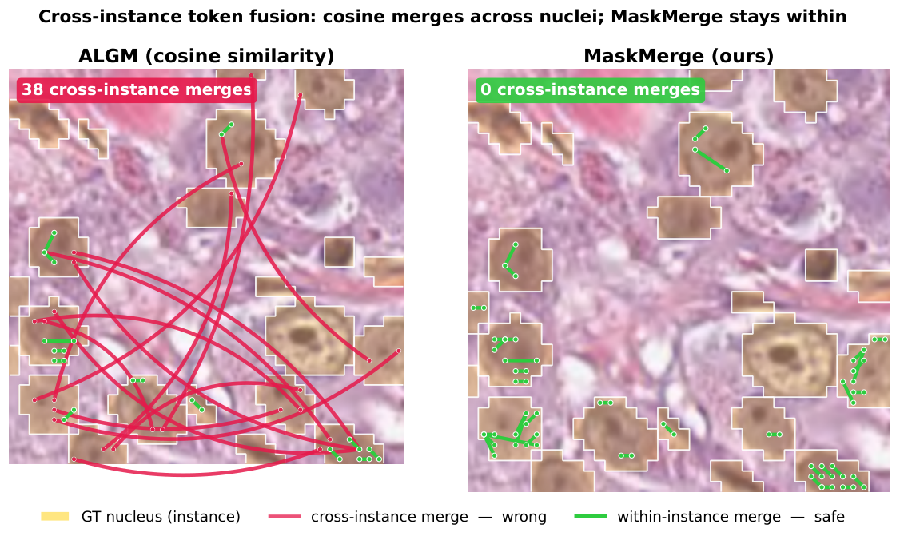

# MaskMerge

**Structure-aware Token Merging for Efficient Instance Segmentation**

Bavesh Balaji · Letian Jiang · Alexander Wong · David Clausi · Sirisha Rambhatla

Accepted to **WACV 2027**. [Project page](https://bavesh-b.github.io/mask_based_token_merging/) · [Paper](https://arxiv.org/abs/2610.22921) · [PDF](https://arxiv.org/pdf/2610.22921) · [WACV accepted papers](https://wacv.thecvf.com/Conferences/2027/AcceptedPapers)

MaskMerge reduces the cost of ViT-based instance segmentation. It first merges similar tokens in local windows. Object-level adaptive merging (OLAM) then uses intermediate mask predictions to constrain global cosine matching to tokens assigned to the same instance. Weighted averaging and a compact token-to-patch map preserve the information needed to reconstruct the final spatial grid.



## Paper results

Reported EoMT ViT-B results from [Table 1](https://arxiv.org/html/2610.22921v1#S4.T1). Throughput uses FP16, batch size 4, in images/s for PanNuke and tiles/s for iSAID and Cityscapes.

| Dataset | ALGM mAP | MaskMerge mAP | Throughput, ALGM → MaskMerge | GFLOPs, ALGM → MaskMerge |
|---|---:|---:|---:|---:|
| PanNuke | 30.1 | **32.1** | 121.5 → 142.8 | 229 → 153 |
| iSAID | 33.1 | **36.2** | 168.8 → 206.9 | 198 → 182 |
| Cityscapes | 19.8 | **19.8** | 107.4 → 105.2 | 347 → 298 |

## Install

Use Python 3.12 and a CUDA-capable PyTorch installation for the training and speed benchmarks.

```bash
git clone https://github.com/Bavesh-B/mask_based_token_merging.git
cd mask_based_token_merging
conda create -n maskmerge python=3.12 -y
conda activate maskmerge
python -m pip install -r requirements.txt
```

## Prepare data

| Dataset | Files under `--data.path` |
|---|---|
| [PanNuke](https://huggingface.co/datasets/RationAI/PanNuke/tree/main/data) | Save the three split Parquets as `fold1.parquet`, `fold2.parquet`, and `fold3.parquet`. Folds 1 and 2 are used for training, and fold 3 for validation. |
| [iSAID](https://captain-whu.github.io/iSAID/dataset.html) | Extract RGB images into `images/train/` and `images/val/`. Place COCO annotations at `annotations/iSAID_train.json` and `annotations/iSAID_val.json`. Preserve the image filenames referenced by the JSON. |
| [Cityscapes](https://www.cityscapes-dataset.com/downloads/) | Extract `leftImg8bit_trainvaltest.zip` and `gtFine_trainvaltest.zip` into the same root. Keep the `leftImg8bit/{train,val}` and `gtFine/{train,val}` directories. |

## Train

Start with a dense EoMT checkpoint for the **same dataset, backbone, and input size**. This PanNuke ViT-B example trains dense EoMT from DINOv2 initialization, then fine-tunes with MaskMerge for 15 epochs. The first command downloads pretrained backbone weights through timm.

```bash
DATA=/path/to/pannuke
DENSE=configs/instance/pannuke/eomt_base_640_finetune.yaml
MASKMERGE=configs/instance/pannuke/maskmerge_base.yaml

EOMT_CHECKPOINT_DIR=checkpoints/pannuke_dense python main.py fit \
  -c "$DENSE" --data.path "$DATA" --trainer.devices 2 --compile_disabled

EOMT_CHECKPOINT_DIR=checkpoints/pannuke_maskmerge python main.py fit \
  -c "$MASKMERGE" --data.path "$DATA" --trainer.devices 2 --compile_disabled \
  --model.ckpt_path checkpoints/pannuke_dense/last.ckpt
```

`--model.ckpt_path` initializes weights for a new training run. Lightning's top-level `--ckpt_path` resumes an interrupted run with its optimizer state. The PanNuke ViT-B configs use 8 images per GPU.

| Dataset / backbone | Dense initialization config | MaskMerge config |
|---|---|---|
| PanNuke / DINOv2 ViT-S | [dense_s_pannuke.yaml](configs/instance/pannuke/dense_s_pannuke.yaml) | [maskmerge_small.yaml](configs/instance/pannuke/maskmerge_small.yaml) |
| PanNuke / DINOv2 ViT-B | [eomt_base_640_finetune.yaml](configs/instance/pannuke/eomt_base_640_finetune.yaml) | [maskmerge_base.yaml](configs/instance/pannuke/maskmerge_base.yaml) |
| PanNuke / DINOv2 ViT-L | [dense_l_pannuke.yaml](configs/instance/pannuke/dense_l_pannuke.yaml) | [maskmerge_large.yaml](configs/instance/pannuke/maskmerge_large.yaml) |
| PanNuke / MAE ViT-B | [eomt_base_mae.yaml](configs/instance/pannuke/mae/eomt_base_mae.yaml) | [maskmerge.yaml](configs/instance/pannuke/mae/maskmerge.yaml) |
| iSAID / DINOv2 ViT-B | [eomt_base_isaid.yaml](configs/instance/isaid/eomt_base_isaid.yaml) | [maskmerge_base.yaml](configs/instance/isaid/maskmerge_base.yaml) |
| Cityscapes / DINOv2 ViT-B | [eomt_base_512_finetune.yaml](configs/instance/cityscapes/eomt_base_512_finetune.yaml) | [maskmerge_base.yaml](configs/instance/cityscapes/maskmerge_base.yaml) |

The primary configs follow the paper's warm-start schedule and merge positions. [Checkpoint compatibility and benchmark instructions](REPRODUCTION.md) describe the archived experiment configs. Checkpoint files are distributed separately from Git. The commands here use the checkpoints produced by training.

## Evaluate

For PanNuke or iSAID, run validation with the corresponding MaskMerge config. Set the confidence threshold to its final training value when loading a completed run.

```bash
CKPT=checkpoints/pannuke_maskmerge/last.ckpt
python main.py validate -c "$MASKMERGE" --data.path "$DATA" \
  --trainer.devices 1 --data.batch_size 4 --model.ckpt_path "$CKPT" \
  --model.network.merge_conf_threshold 0.0
```

The logged `metrics/val_ap_all` is a fraction. Multiply it by 100 to obtain the mAP scale used in the paper. For Cityscapes, use native-resolution sliding-window evaluation.

```bash
python -m scripts.instance.eval_native_instance --tag maskmerge \
  --config configs/instance/cityscapes/maskmerge_base.yaml \
  --ckpt checkpoints/cityscapes_maskmerge/last.ckpt \
  --data-path /path/to/cityscapes --mode slide --tile 512 1024 --global-pass
```

See [benchmarking and baselines](REPRODUCTION.md), the [Mask2Former extension](extensions/mask2former/README.md), and [additional EoMT segmentation tasks](MASKMERGE.md).

## Citation

```bibtex
@inproceedings{balaji2027maskmerge,
  title     = {MaskMerge: Structure-aware Token Merging for Efficient Instance Segmentation},
  author    = {Balaji, Bavesh and Jiang, Letian and Wong, Alexander and Clausi, David and Rambhatla, Sirisha},
  booktitle = {IEEE/CVF Winter Conference on Applications of Computer Vision (WACV)},
  year      = {2027},
  url       = {https://arxiv.org/abs/2610.22921}
}
```

## Acknowledgments

The implementation builds on [EoMT](https://github.com/tue-mps/eomt), [ALGM](https://github.com/tue-mps/algm-segmenter), [ToMe](https://github.com/facebookresearch/ToMe), and [Mask2Former](https://github.com/facebookresearch/Mask2Former). See the [repository license](LICENSE), the [ALGM and ToMe notices](LICENSE-ALGM), and the [Mask2Former license](extensions/mask2former/LICENSE). Figure 2 is from Balaji et al., [MaskMerge](https://arxiv.org/abs/2610.22921), under [CC BY 4.0](https://creativecommons.org/licenses/by/4.0/).
